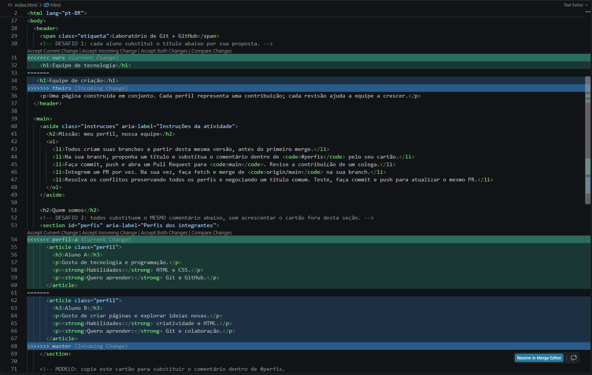

# Atividade-01

## Relatório: simulação e resolução de conflito

A simulação foi feita localmente com duas branches, `perfil-a` e `master`, para representar as alterações de dois colaboradores. As duas versões modificaram o título da página e o conteúdo da seção de perfis do `index.html`.

Ao integrar as branches, o Git identificou conflitos nessas partes. A captura abaixo mostra os trechos em conflito no VS Code:

Para resolver o conflito, foi escolhido um título que combina as duas propostas e foram mantidos os cartões dos alunos A e B. Depois, os marcadores de conflito foram removidos, o arquivo foi salvo e a resolução foi registrada em um commit.
